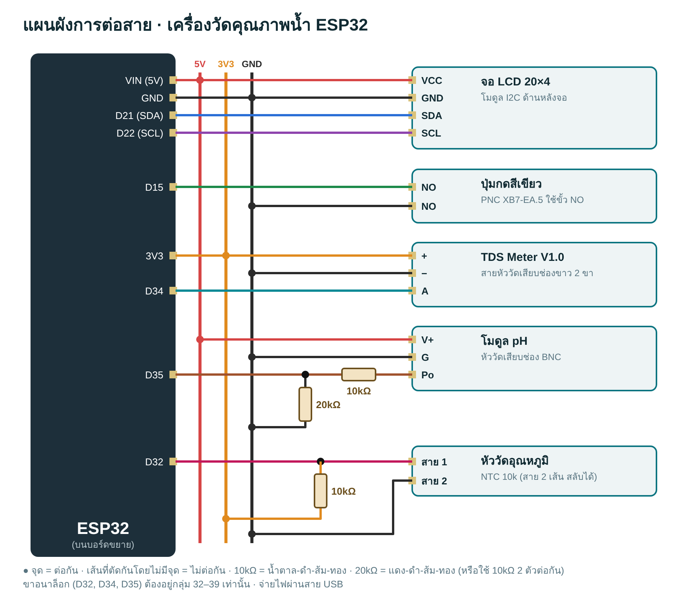

# 💧 เครื่องวัดคุณภาพน้ำ (Water Quality Meter)

เครื่องวัด **pH**, **TDS** (สารที่ละลายในน้ำ) และ **อุณหภูมิน้ำ** ด้วย ESP32
กดปุ่มสีเขียวแล้วผลจะถูกส่งไปที่หน้าเว็บบนมือถือ หน้าเว็บจะวิเคราะห์คุณภาพน้ำ
คาดคะเนว่าน้ำมาจากแหล่งไหน และบันทึกวันเวลาและสถานที่ไว้ให้

## การทำงาน

```
 เซนเซอร์ 3 ตัว ──► ESP32 ──► จอ LCD (แสดงค่าสดตลอดเวลา)
                     │
             กดปุ่มสีเขียว
                     │
                     ▼
        มือถือ (WiFi "WaterMeter") ──► หน้าเว็บวิเคราะห์ผล
```

1. **วัดค่า** เซนเซอร์ทั้ง 3 ตัวอ่านค่าทุก 1 วินาที และแสดงบนจอ LCD
   ถ้าเซนเซอร์ไหนยังไม่ได้ต่อ หรือหัววัดยังไม่ได้จุ่มน้ำ จะแสดงเป็น **`-`**
2. **กดปุ่มสีเขียว** ESP32 จะวัดละเอียด 8 รอบ เอาค่าเฉลี่ย แล้วส่งไปที่หน้าเว็บ
   (กดค้าง 2 วินาที จอจะแสดงชื่อ WiFi และรหัสผ่าน)
3. **หน้าเว็บ** แสดงผล:
   - ค่าทั้ง 3 พร้อมสเกลและเกณฑ์มาตรฐาน
   - คะแนนคุณภาพน้ำ (0–100)
   - การคาดคะเนแหล่งที่มาของน้ำ พร้อมเปอร์เซ็นต์ความมั่นใจ
   - ความเหมาะกับการใช้งาน: ดื่ม ใช้ในบ้าน รดน้ำพืช และเลี้ยงปลา
   - คำแนะนำ
   - วันเวลาและสถานที่เก็บตัวอย่าง
   - ประวัติการตรวจทุกครั้ง

## อุปกรณ์

| # | อุปกรณ์ | หน้าที่ |
|---|---|---|
| 1 | บอร์ด ESP32 (30 ขา) + บอร์ดขยายขา | สมองของเครื่อง และปล่อย WiFi |
| 2 | จอ LCD 20×4 + โมดูล I2C | แสดงค่าสด |
| 3 | ปุ่มกด PNC XB7-EA.5 (สีเขียว) | กดส่งผลไปที่เว็บ |
| 4 | TDS Meter V1.0 + หัววัด | วัด TDS (0–1000 ppm) |
| 5 | โมดูล pH + หัววัด BNC | วัด pH |
| 6 | หัววัดอุณหภูมิ NTC 10k (2 สาย) | วัดอุณหภูมิน้ำ |
| 7 | ตัวต้านทาน **10kΩ × 2** (น้ำตาล-ดำ-ส้ม-ทอง) | ตัวแบ่งแรงดัน pH 1 ตัว และใช้กับ NTC 1 ตัว |
| 8 | ตัวต้านทาน **20kΩ × 1** (แดง-ดำ-ส้ม-ทอง) | ตัวแบ่งแรงดัน pH (ไม่มีก็ใช้ 10kΩ 2 ตัวต่ออนุกรมแทน) |

> 🛒 **ต้องซื้อเพิ่ม:** ตัวต้านทาน 10kΩ จำนวน 4 ตัว (เผื่อใช้แทน 20kΩ) ร้านอิเล็กทรอนิกส์ขายตัวละไม่ถึง 1 บาท
> ตัวต้านทาน 100Ω (น้ำตาล-ดำ-น้ำตาล-ทอง) ที่มีอยู่ ใช้ในโปรเจคนี้ไม่ได้

## แบ่งงาน: เว็บแก้ใน VS Code · อุปกรณ์แก้ใน Arduino IDE

| ส่วน | เปิดด้วย | ไฟล์ |
|---|---|---|
| **หน้าเว็บ** | **VS Code** (เปิดโฟลเดอร์โปรเจคทั้งโฟลเดอร์) | `web/index.html`, `web/style.css`, `web/app.js`, `web/model.js` |
| **อุปกรณ์ / ESP32** | **Arduino IDE** | `firmware/water_quality_meter/water_quality_meter.ino` + แท็บ `config.h` |

### แก้เว็บใน VS Code
1. File → Open Folder → เลือกโฟลเดอร์ `water-quality-meter`
2. VS Code จะแนะนำให้ติดตั้ง **Live Server** ให้กด Install
3. เปิด `web/index.html` แล้วกด **Go Live** มุมขวาล่าง หน้าเว็บจะเปิดที่ `http://127.0.0.1:5500`
   - ถ้าคอมไม่ได้ต่อเครื่องวัด เว็บจะเข้า **โหมดทดลอง** ให้ใส่ค่าเอง
   - ถ้าจะทดสอบกับเครื่องจริง ให้ต่อ WiFi ของคอมเข้า `WaterMeter` แล้วกด **เชื่อมต่อ** (ที่อยู่ `192.168.4.1`)
   - แก้ไฟล์แล้วกดบันทึก หน้าเว็บจะรีเฟรชเอง
4. แก้เสร็จแล้วกด **Ctrl+Shift+B** (งาน "สร้างหน้าเว็บให้ ESP32") เพื่อรวมเว็บเป็นไฟล์ `web_page.h`
   (ต้องมี Python ในเครื่อง ดาวน์โหลดได้ที่ python.org)
5. กลับไปที่ Arduino IDE แล้วกด Upload เว็บใหม่จะไปอยู่ในเครื่องวัด

### แก้อุปกรณ์ใน Arduino IDE
- **ขา WiFi และค่าวงจร** อยู่ในแท็บ `config.h` เช่น อยากย้ายปุ่มไปขาอื่น ก็แก้ `PIN_BUTTON` ได้เลย
- **การทำงานของเครื่อง** อยู่ใน `water_quality_meter.ino`
- **ห้ามแก้** `web_page.h` ตรงๆ เพราะไฟล์นี้สร้างจาก VS Code (ข้อ 4 ด้านบน)

## การต่อวงจร



| อุปกรณ์ | ขาอุปกรณ์ | ต่อกับ |
|---|---|---|
| จอ LCD | VCC / GND / SDA / SCL | **VIN (5V)** / GND / **D21** / **D22** |
| ปุ่มกด | ขั้ว NO ขั้วที่ 1 / ขั้ว NO ขั้วที่ 2 | **D15** / GND |
| TDS | + / − / A | **3V3** / GND / **D34** |
| pH | V+ / G | **VIN (5V)** / GND |
| pH | Po | → 10kΩ → **D35** และจาก D35 → 20kΩ → GND |
| อุณหภูมิ | สาย 1 | **D32** และจาก D32 → 10kΩ → **3V3** |
| อุณหภูมิ | สาย 2 | GND |

### ตัวแบ่งแรงดันของ pH
โมดูล pH จ่ายแรงดันได้ถึง 5V แต่ ESP32 รับได้แค่ 3.3V ตัวแบ่งแรงดันช่วยลดแรงดันเหลือ 2/3
และยังช่วยให้ระบบรู้ว่า **ยังไม่ได้ต่อโมดูล pH** (ค่าจะเป็น 0 แล้วแสดง `-`)

```
pH Po ──[ 10kΩ ]──┬── D35
                  │
               [ 20kΩ ]   (หรือ 10kΩ + 10kΩ ต่อกัน)
                  │
                 GND
```

### หัววัดอุณหภูมิ NTC
```
3V3 ──[ 10kΩ ]──┬── D32
                │
              [NTC]   ← หัววัดสแตนเลส (สลับสายได้ ไม่มีขั้ว)
                │
               GND
```

### การตรวจว่าเซนเซอร์ "ไม่ได้วัด" (แสดง `-`)
| เซนเซอร์ | แสดง `-` เมื่อ |
|---|---|
| pH | ไม่ได้ต่อโมดูล หรือแรงดันเกินช่วงที่อ่านได้ |
| TDS | หัววัดไม่ได้จุ่มน้ำ หรือไม่ได้ต่อโมดูล (สัญญาณแกว่ง) |
| อุณหภูมิ | สายหลุด สายช็อต หรือลืมต่อตัวต้านทาน 10kΩ |

ถ้าไม่ได้วัดอุณหภูมิ ระบบจะใช้ 25°C ในการคำนวณ TDS แทน

## วิธีลงโปรแกรม

1. ติดตั้ง **Arduino IDE** บนคอมพิวเตอร์
2. ไปที่ File → Preferences → *Additional boards manager URLs* แล้วใส่
   `https://espressif.github.io/arduino-esp32/package_esp32_index.json`
3. Tools → Board → Boards Manager → ค้นหา **esp32** แล้วกด Install
4. Tools → Manage Libraries → ค้นหา **LiquidCrystal I2C** (by Frank de Brabander) แล้วกด Install
5. เปิดไฟล์ `firmware/water_quality_meter/water_quality_meter.ino`
   (ไฟล์ `web_page.h` ในโฟลเดอร์เดียวกันจะถูกเปิดเป็นแท็บด้วย)
6. Tools → Board → **ESP32 Dev Module** แล้วเลือก Port ให้ถูก
7. กด Upload (ถ้าค้างที่ `Connecting...` ให้กดปุ่ม **BOOT** บนบอร์ดค้างไว้)

## วิธีใช้งาน

1. เปิดเครื่อง รอจอขึ้นค่า pH / TDS / Temp
2. ใช้มือถือต่อ WiFi ชื่อ **`WaterMeter`** รหัส **`12345678`**
3. เปิดเบราว์เซอร์ไปที่ **http://192.168.4.1**
4. พิมพ์ชื่อสถานที่เก็บตัวอย่างน้ำในช่อง "สถานที่เก็บตัวอย่าง"
5. จุ่มหัววัดทั้งหมดลงในน้ำ รอให้ค่าบนจอนิ่งประมาณ 30 วินาที
6. **กดปุ่มสีเขียว** ผลวิเคราะห์จะขึ้นบนมือถือภายใน 1–2 วินาที

> หน้าเว็บใช้เวลาจากนาฬิกาของมือถือ (ESP32 ไม่มีนาฬิกาในตัว)
> ส่วน GPS ใช้ไม่ได้เมื่อเปิดเว็บจาก WiFi ของเครื่อง (เบราว์เซอร์อนุญาตเฉพาะเว็บ https) จึงให้พิมพ์ชื่อสถานที่แทน

### หน้าเว็บแบบไม่ต้องมีเครื่อง (โหมดทดลอง)
เปิด `web/index.html` ด้วย Live Server ใน VS Code (หรือดับเบิลคลิกเปิดในเบราว์เซอร์) ถ้าหาเครื่องวัดไม่เจอ
หน้าเว็บจะเข้าโหมดทดลอง ให้ใส่ค่า pH / TDS / อุณหภูมิเองเพื่อทดสอบระบบวิเคราะห์

## ระบบวิเคราะห์และโมเดลประเมินแหล่งน้ำ

### เกณฑ์คุณภาพน้ำที่ใช้
| ค่า | เกณฑ์ | ที่มา |
|---|---|---|
| pH | 6.5–8.5 | เกณฑ์น้ำดื่มบรรจุภาชนะปิดสนิท (กระทรวงสาธารณสุข) |
| TDS | ไม่เกิน 500 mg/L | เกณฑ์น้ำดื่มบรรจุภาชนะปิดสนิท (กระทรวงสาธารณสุข) |
| TDS | ต่ำกว่า 300 ดีมาก / 300–600 ดี / 600–900 พอใช้ / 900–1200 ไม่ดี / เกิน 1200 แย่ | ระดับรสชาติน้ำของ WHO |
| รดน้ำพืช | TDS ต่ำกว่า 450 ไม่มีข้อจำกัด / 450–2000 ใช้ได้บ้าง | FAO Irrigation & Drainage Paper 29 |

### โมเดลประเมินแหล่งน้ำ (AI)
ใช้ **Gaussian Naive Bayes** ทำนาย 8 แหล่ง:
น้ำ RO/น้ำกลั่น · น้ำฝน · น้ำดื่มบรรจุขวด · น้ำแร่ · น้ำประปา · น้ำผิวดิน · น้ำบาดาล/น้ำบ่อ · น้ำกร่อย

- ถ้าเซนเซอร์บางตัวไม่ได้วัด โมเดลยังทำนายได้จากค่าที่เหลือ
- ถ้า TDS เกิน 1000 ppm (เพดานของเซนเซอร์) โมเดลจะรู้ว่าค่าจริงสูงกว่านั้น และคำนวณให้ถูกต้อง
- โมเดลเริ่มต้น (`model/reference_model.json`) สร้างจาก**ช่วงค่าอ้างอิงในเอกสาร** ยังไม่ได้เทรนด้วยน้ำที่วัดจริง

> ⚠️ **ความแม่นยำมีขีดจำกัด:** วัดได้แค่ 3 ค่า และหลายแหล่งมีค่าใกล้กันมาก
> (เช่น น้ำประปา น้ำแร่ และน้ำแม่น้ำ) ถ้าทดสอบกับข้อมูลที่สุ่มจากช่วงค่าอ้างอิง จะทายถูกประมาณ **65%**
> คู่ที่สับสนบ่อยคือน้ำ RO กับน้ำฝน และน้ำประปากับน้ำแร่
> หน้าเว็บจึงแสดงเปอร์เซ็นต์ความมั่นใจทุกครั้ง และบอกเมื่อระบุแหล่งได้ไม่ชัด

### เพิ่มความแม่นยำด้วยข้อมูลจริง
1. วัดน้ำที่**รู้แหล่งแน่นอน** หลายๆ ครั้ง เช่น น้ำประปาที่บ้าน น้ำบ่อ น้ำฝนที่รองไว้ (แหล่งละ 10 ครั้งขึ้นไป)
2. ในตารางประวัติบนหน้าเว็บ ช่อง **"แหล่งน้ำจริง"** ให้เลือกแหล่งที่ถูกต้อง
3. กด **ส่งออก CSV** แล้วบันทึกเป็นไฟล์ `model/samples.csv`
4. รันบนคอมพิวเตอร์
   ```bash
   python3 model/train.py model/samples.csv
   ```
   (หรือใน VS Code: Terminal → Run Task → "เทรนโมเดลจาก model/samples.csv")
   สคริปต์จะเทรนโมเดล แจ้งความแม่นยำที่ทดสอบจากข้อมูลจริง และอัปเดต `web/model.js` กับ `web_page.h` ให้อัตโนมัติ
5. อัปโหลดโค้ดลง ESP32 ใหม่

## การคาลิเบรต (ทำครั้งแรกครั้งเดียว)

เปิด Tools → Serial Monitor ตั้งค่าเป็น **115200 baud** แล้วพิมพ์คำสั่ง:

| คำสั่ง | ทำอะไร |
|---|---|
| `cal7` | จุ่มหัววัด pH ในน้ำยา **pH 7.00** รอ 1 นาทีแล้วพิมพ์ |
| `cal4` | ล้างหัววัดแล้วจุ่มน้ำยา **pH 4.00** รอ 1 นาทีแล้วพิมพ์ |
| `tds 342` | จุ่มหัววัด TDS ในน้ำยามาตรฐาน (เช่น 342 ppm) แล้วพิมพ์ค่าจริงต่อท้าย |
| `show` | ดูค่าคาลิเบรตปัจจุบัน |
| `reset` | ล้างค่าคาลิเบรตกลับเป็นค่าเริ่มต้น |

## โครงสร้างไฟล์

```
firmware/water_quality_meter/      ← เปิดด้วย Arduino IDE
  water_quality_meter.ino          การทำงานของเครื่อง
  config.h                         ขา ค่าวงจร WiFi (แก้ตรงนี้)
  web_page.h                       หน้าเว็บที่ฝังในเครื่อง (สร้างอัตโนมัติ ห้ามแก้)
web/                               ← แก้ใน VS Code
  index.html                       โครงหน้าเว็บ
  style.css                        หน้าตา สี ตัวอักษร
  app.js                           การวิเคราะห์น้ำ การเชื่อมต่อเครื่อง ประวัติ
  model.js                         โมเดล AI (train.py เขียนทับให้)
model/
  reference_model.json             โมเดลเริ่มต้นจากค่าอ้างอิง
  train.py                         เทรนโมเดลจากข้อมูลจริง
  samples_template.csv             รูปแบบไฟล์ข้อมูล
tools/
  build_web.py                     รวม web/ เป็น web_page.h (Ctrl+Shift+B)
  make_wiring.py                   วาดแผนผังวงจร
docs/wiring.svg, wiring.png        แผนผังการต่อสาย
.vscode/                           ตั้งค่า VS Code (Live Server, ปุ่มลัด build)
```

### API ของเครื่องวัด (สำหรับแก้เว็บ)
| เส้นทาง | ใช้ทำอะไร |
|---|---|
| `GET /api/state` | ค่าสด (`live`) และผลล่าสุดจากการกดปุ่ม (`last`) ค่าที่ไม่ได้วัดเป็น `null` |
| `POST /api/measure` | สั่งวัดและส่งผล เหมือนกดปุ่มเขียว |
| `POST /api/time?epoch=...` | ตั้งเวลาให้เครื่อง (หน้าเว็บส่งให้อัตโนมัติ) |

## แก้ปัญหาเบื้องต้น

| อาการ | วิธีแก้ |
|---|---|
| จอติดแต่ไม่มีตัวหนังสือ | หมุนตัวปรับสีฟ้าด้านหลังจอ (ปรับความเข้ม) |
| จอไม่ติดเลย | ตรวจสาย SDA→D21, SCL→D22 และดูข้อความใน Serial Monitor |
| ค่าขึ้น `-` ตลอด | ดูตาราง "การตรวจว่าเซนเซอร์ไม่ได้วัด" ด้านบน |
| อุณหภูมิเพี้ยนมาก | NTC อาจมีค่า B ไม่ใช่ 3950 ให้แก้ `NTC_BETA` ในโค้ด |
| กดปุ่มแล้วเว็บไม่ขึ้นผล | ตรวจว่ามือถือยังต่อ WiFi `WaterMeter` อยู่ (มุมขวาบนของเว็บต้องเป็นจุดสีเขียว) |
| มือถือตัด WiFi เอง | มือถือบางรุ่นตัดเพราะ WiFi นี้ไม่มีอินเทอร์เน็ต ให้กด "ใช้ต่อ / Keep connection" |

## การดูแลหัววัด pH
- เก็บหัววัดในฝาครอบที่มีน้ำยาเก็บรักษา (KCl) **ห้ามปล่อยให้แห้ง**
- ล้างด้วยน้ำกลั่นทุกครั้งก่อนย้ายไปวัดน้ำตัวอย่างอื่น
